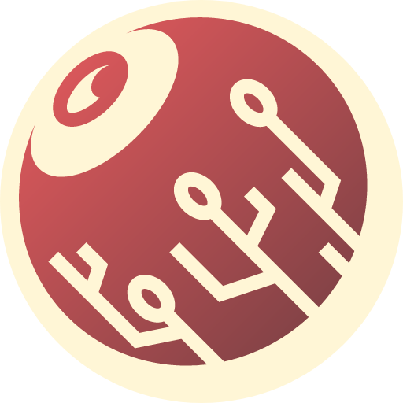
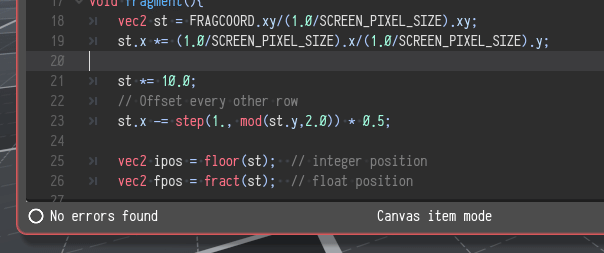
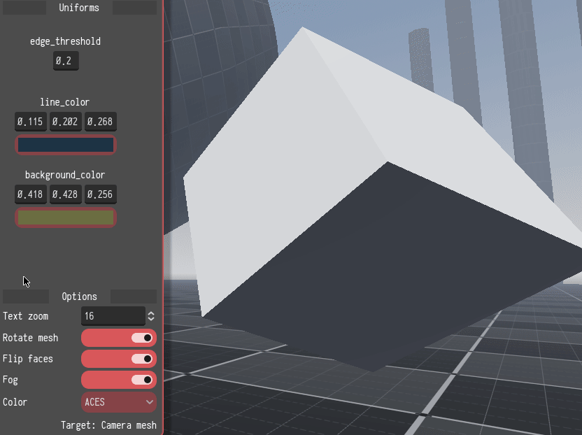
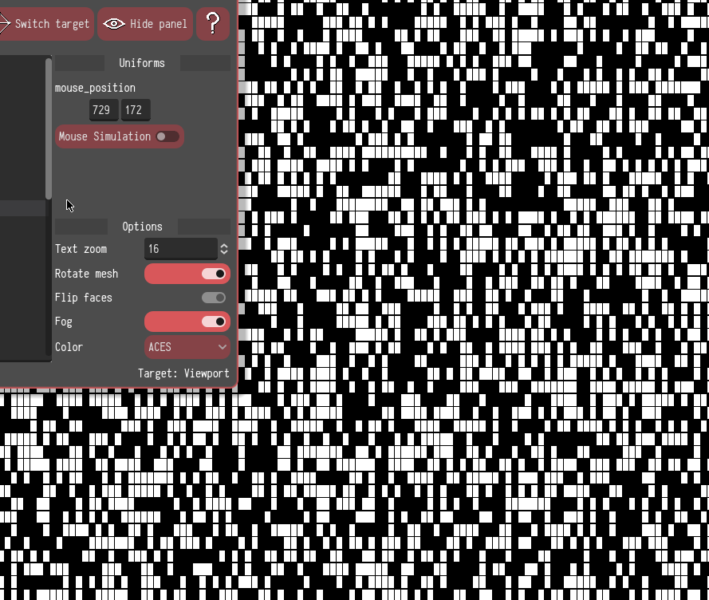
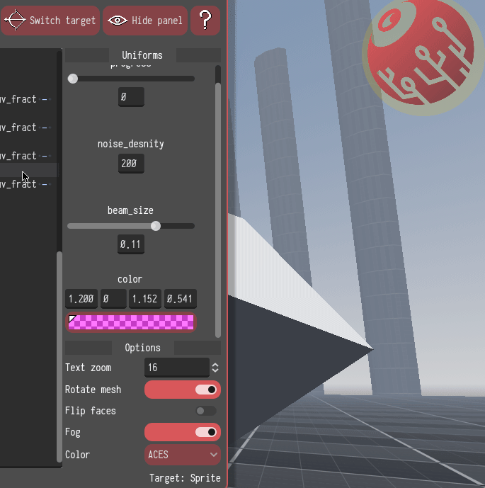

# Godot Shaders Sketchbook

Godot Shaders Sketchbook is a small sandbox for prototyping Godot shaders. You can write, test and iterate on your own code without distractions, or experiment with shaders from the [community](https://godotshaders.com/) before using them in a project.

## Requirements

The program is built for **Godot 4.2** and its shading language (the `.gdshader` dialect based on GLSL ES 3.0). It depends on the engine behaviour and shader built-ins of that release, so it does not run correctly on Godot 4.3 or later without changes.

## Features

* Compact live-coding environment with an error status bar
* Syntax highlighting for the Godot 4.2 shading language
* Hot swapping between common targets:
    * Sprite and viewport (for `canvas_item` shaders)
    * Cube and camera-filter mesh (for `spatial` shaders)
* Widgets for the most common uniform types:
    * Color picker for `vec3` and `vec4`
    * Mouse input simulation for `vec2`
    * Sliders for `int` and `float`
    * Preloaded textures for `sampler2D`

## Showcase

You can try the tool [in the browser](http://horologiq.itch.io/godot-shaders-sketchbook), although the desktop build is recommended.

Error handling

vec3 widget with color picker

vec2 widget with mouse simulation

Float widget and target hot swapping

## License

Written by P. Cervantes (Horologiq) and released as free software under the MIT license.
